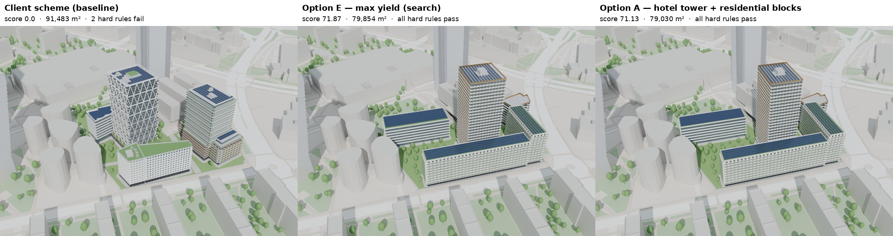

# Capacity study — options vs the client scheme

Generated by `tools/score_options.py` from each scheme's `model/metrics.json`. Rules: `02_regulations/rules.yaml`
(Metropolitan Plan + Prague building regulations). Score = above-ground GFA (thousand m²) if every hard rule
passes, minus 10 % per missed quality floor (daylight proxy ≤ 0.15 failing, courtyard sun ≥ 2 h on 21 March,
built-up ratio ≤ 0.45). Estimates: hotel 62 % net / 34 m² per key; flats 78 % net / 65 m²; parking zone 02 ASSUMED.
Basement levels: fewest 3.5 m levels whose capacity covers the PSP §25 minimum (`basement_levels: auto`).

| Rank | Scheme | Score | GFA above ground m² | FAR | Max height m | Storeys | Hotel keys | Flats | Parking need / capacity | Basement levels | §21 failing windows | Daylight proxy fail | Courtyard sun h | Built-up |
|---|---|---|---|---|---|---|---|---|---|---|---|---|---|---|
| 1 | Option E — max yield (search) | **71.87** | 79,854 | 4.842 | 95.2 | 27 | 426 | 402 | 665 / 781 | 2 | 0 | 0.201 | 2.0 | 0.386 |
| 2 | Option A — hotel tower + residential blocks | **71.13** | 79,030 | 4.792 | 95.2 | 27 | 441 | 402 | 646 / 781 | 2 | 0 | 0.194 | 2.01 | 0.377 |
| 3 | Option D — client scheme, made compliant | **68.74** | 85,928 | 5.21 | 83.8 | 22 | 196 | 626 | 664 / 730 | 3 | 0 | 0.262 | 3.38 | 0.488 |
| 4 | Option B — twin towers on a podium | **62.85** | 62,850 | 3.811 | 95.2 | 27 | 435 | 244 | 467 / 781 | 2 | 0 | 0.096 | 3.23 | 0.348 |
| 5 | Option C — mid-rise city blocks (no towers) | **55.52** | 61,684 | 3.74 | 38.4 | 10 | 317 | 257 | 500 / 781 | 2 | 0 | 0.156 | 2.02 | 0.378 |
| 6 | Client scheme (baseline) | **0.0** | 91,483 | 5.547 | 83.8 | 22 | 257 | 632 | 728 / 487 | 2 | 10 | 0.251 | 3.33 | 0.502 |

## One-page comparison — client scheme vs the two best options (D9)

| | Client scheme (baseline) | Option E — max yield (search) | Option A — hotel tower + residential blocks |
|---|---|---|---|
| Score (GFA k m² × quality) | **0.0** | **71.87** | **71.13** |
| Hard rules (MPP + PSP) | 2 fail | all pass | all pass |
| Above-ground GFA m² | 91,483 | 79,854 | 79,030 |
| … share of the client's GFA | 100% | 87% | 86% |
| FAR | 5.547 | 4.842 | 4.792 |
| Max height m / storeys | 83.8 / 22 | 95.2 / 27 | 95.2 / 27 |
| Hotel keys / flats (est.) | 257 / 632 | 426 / 402 | 441 / 402 |
| Parking need / capacity | 728 / 487 | 665 / 781 | 646 / 781 |
| Basement levels | 2 | 2 | 2 |
| §21 failing neighbour windows | 10 | 0 | 0 |
| Daylight: windows below VSC 15 % | 25% | 20% | 19% |
| Courtyard sun 21 March h | 3.33 | 2.0 | 2.01 |
| Built-up ratio | 0.502 | 0.386 | 0.377 |

Reading:
- The client scheme is not permittable as drawn: PSP §21: neighbour windows failing the 45°/45° distance angle; PSP §25: parking capacity minus required minimum (spaces).
- **Option E — max yield (search)** passes every hard rule with 87% of the client's floor area; quality floors missed: daylight_proxy_fail_ratio.
- **Option A — hotel tower + residential blocks** passes every hard rule with 86% of the client's floor area; quality floors missed: daylight_proxy_fail_ratio.
- Largest legal floor area: **Option D — client scheme, made compliant** with 85,928 m² (94% of the client's), score 68.74 because it misses quality floors (daylight_proxy_fail_ratio, built_up_ratio).
- All numbers are capacity-study estimates from the parametric model (see assumptions above); they rank options, they are not a permit check.

## Hotel programme (D8)

Keys from room floors only; mix 70 % standard 28 m² / 20 % superior 34 m² / 10 % suites 56 m² (net), 62 % room-floor
efficiency; benchmarks for a 4* city hotel: 300–450 keys, lobby + F&B ≥ 2.0, meeting ≥ 1.5, spa ≥ 0.8 m² per key
(all ASSUMED until the client brief arrives).

| Scheme | Keys | Standard / superior / suites | Lobby + F&B m² | Meeting m² | Spa m² | Flags |
|---|---|---|---|---|---|---|
| Option E — max yield (search) | 426 | 298 / 85 / 43 | 1,224 | 735 | 490 | OK |
| Option A — hotel tower + residential blocks | 441 | 309 / 88 / 44 | 1,200 | 720 | 480 | OK |
| Option D — client scheme, made compliant | 196 | 137 / 39 / 20 | 2,484 | 566 | 377 | 196 keys < 300: below a typical 4* city hotel |
| Option B — twin towers on a podium | 435 | 304 / 87 / 44 | 900 | 2,784 | 360 | OK |
| Option C — mid-rise city blocks (no towers) | 317 | 222 / 63 / 32 | 2,048 | 1,229 | 819 | OK |
| Client scheme (baseline) | 257 | 180 / 51 / 26 | 2,520 | 0 | 0 | 257 keys < 300: below a typical 4* city hotel; meeting 0.0 m²/key < 1.5; spa 0.0 m²/key < 0.8 |

## Notes per scheme

- **Option E — max yield (search)** — all hard rules pass; quality misses: daylight_proxy_fail_ratio 0.201 (want ≤ 0.15)
- **Option A — hotel tower + residential blocks** — all hard rules pass; quality misses: daylight_proxy_fail_ratio 0.194 (want ≤ 0.15)
- **Option D — client scheme, made compliant** — all hard rules pass; quality misses: daylight_proxy_fail_ratio 0.262 (want ≤ 0.15); built_up_ratio 0.488 (want ≤ 0.45)
- **Option B — twin towers on a podium** — all hard rules pass; quality floors met
- **Option C — mid-rise city blocks (no towers)** — all hard rules pass; quality misses: daylight_proxy_fail_ratio 0.156 (want ≤ 0.15)
- **Client scheme (baseline)** — FAILS: PSP §21: neighbour windows failing the 45°/45° distance angle; PSP §25: parking capacity minus required minimum (spaces); quality misses: daylight_proxy_fail_ratio 0.251 (want ≤ 0.15); built_up_ratio 0.502 (want ≤ 0.45); §21 neighbours: [['54,48', 7], ['-58,-26', 3]]
